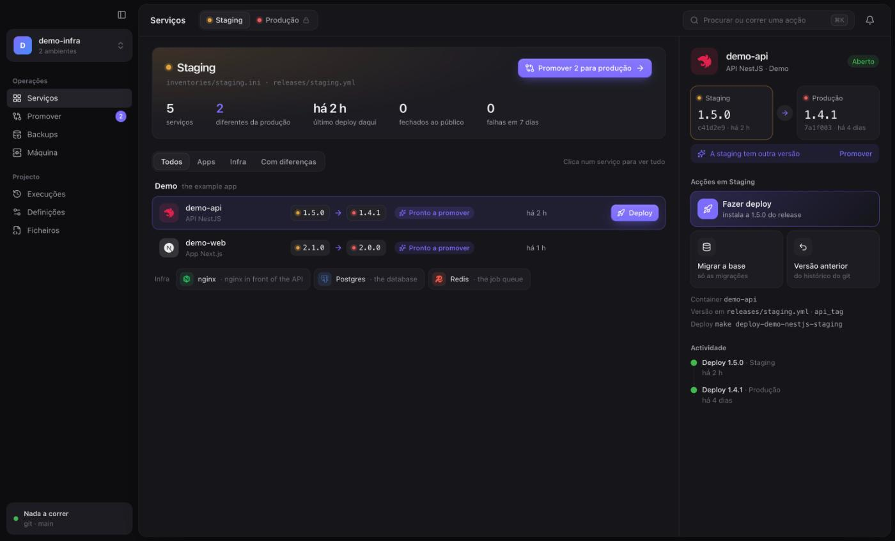
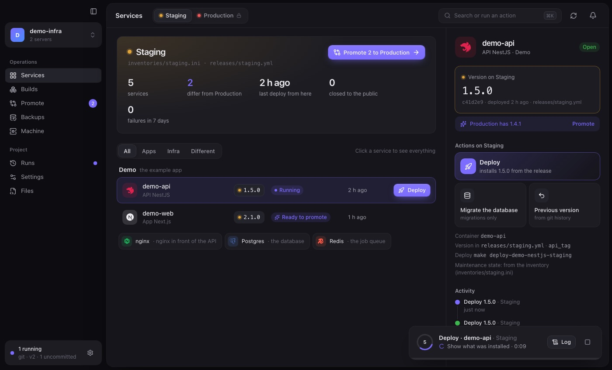
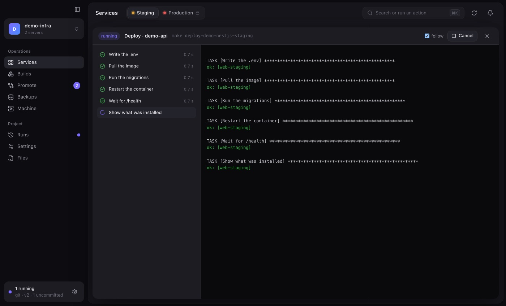
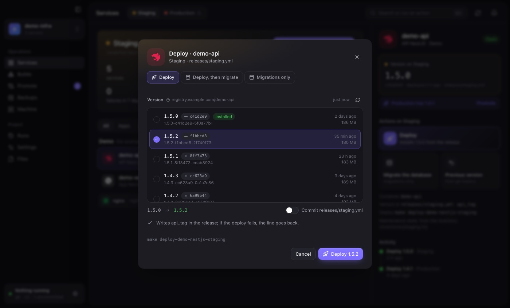
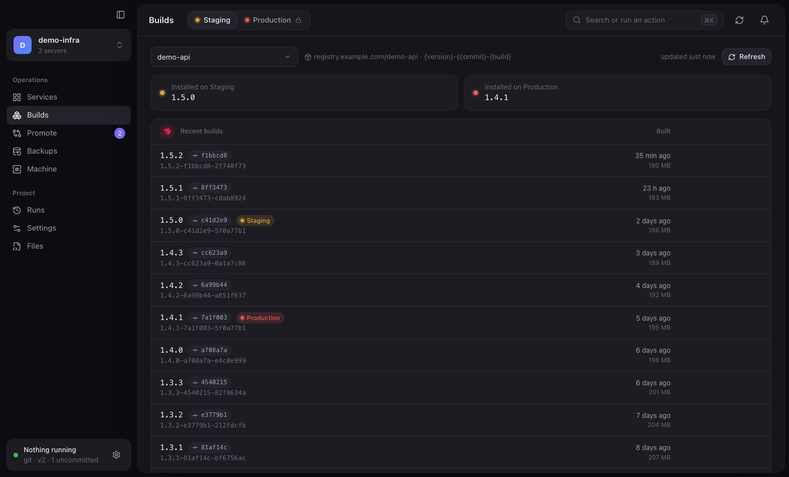
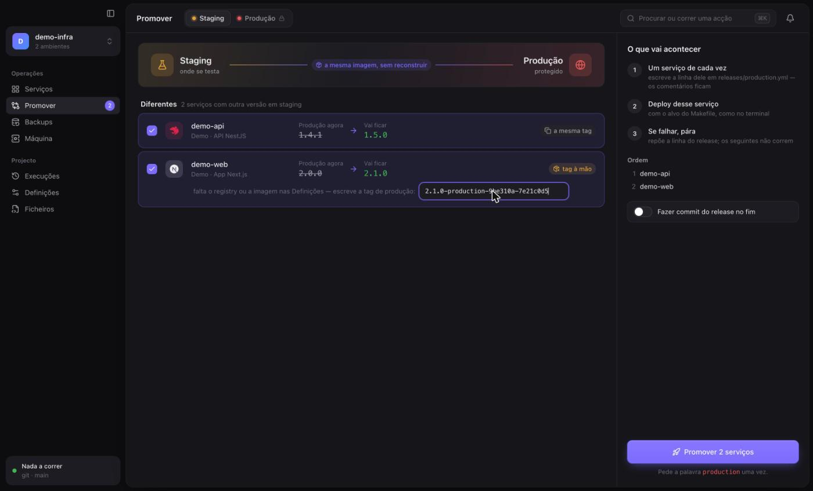
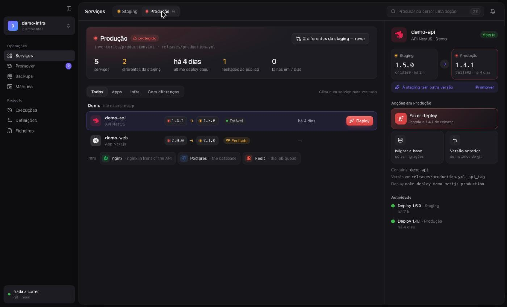
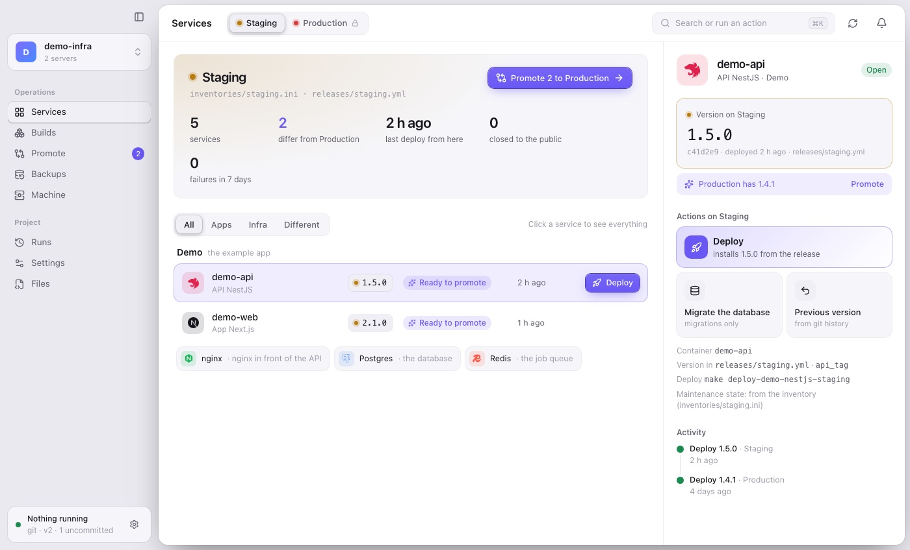
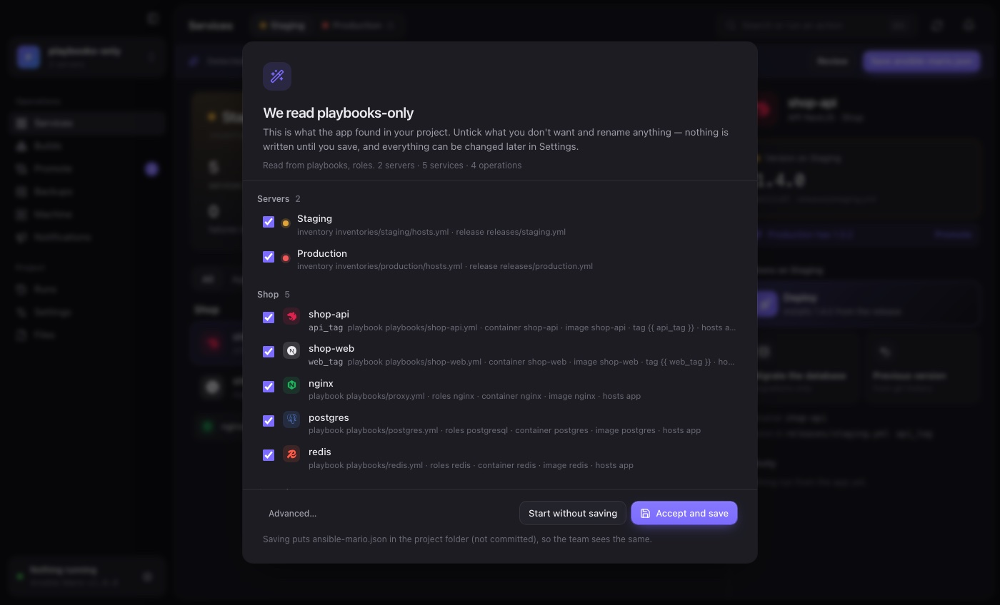
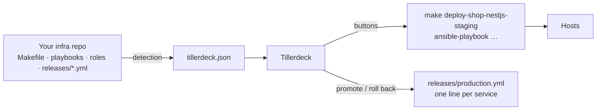

<h1>
  <picture>
    <source media="(prefers-color-scheme: dark)" srcset="docs/brand/marca-horizontal-branco.svg">
    
  </picture>
</h1>

**Steer your infra by hand.** Tillerdeck (formerly *Ansible Mario*) is a desktop app that puts buttons on your Ansible project: deploy, promote, back up and manage machines, built on the CLI you already use.

**v2.1.0:** several projects open at once, and settings detected from your playbooks and roles.

[](https://github.com/mariocosttaa/tillerdeck/releases) [](https://github.com/mariocosttaa/tillerdeck/releases) [](https://docs.ansible.com) [](https://tauri.app) [](https://www.rust-lang.org) [](https://react.dev) [](https://tailwindcss.com) [](LICENSE)

Tillerdeck turns an Ansible repository into an operations app:
- **Servers and products:** pick a server at the top (Staging, Production); see the products that live on it and every service's version.
- **Actions:** buttons to deploy, migrate, seed, close a service for maintenance and reopen it.
- **Builds:** the latest images in your registry (or commits of your app repo), with dates, and where each one is installed. Deploy any of them.
- **Promotion:** move the image staging tested to production, one service at a time.
- **Backups and machines:** restore, provision and verify.
- **Live runs:** every run shows its progress and full log.

Nothing is reimplemented. Every button runs your own Makefile target or playbook through the real `make` / `ansible-playbook`, with your `ansible.cfg`, vault and callbacks.

> The interface is in English by default, with European Portuguese available. It follows the system theme, or stays light or dark.

## Preview



*Services: environment summary, each service's version path (staging → production), and an inspector with the actions.*

| A run in progress | The full log |
| --- | --- |
|  |  |
| *A floating card shows the current step, taken from the `TASK [...]` lines.* | *The steps with timings, plus the colour log. You can cancel from here.* |

| Deploy: choose the mode, then the version | Builds |
| --- | --- |
|  |  |
| *Deploy, deploy + migrations or seed, then any build from the registry. The release line is written first and put back if the deploy fails.* | *Recent builds with date, commit and size, and which server runs each one.* |

| Promote staging → production | Production |
| --- | --- |
|  |  |
| *The same image, one service at a time. Per-environment tags come from the registry, or you type them in.* | *Protected: every action asks you to type `production`.* |



*Light mode. Auto follows the system.*



*First open: the app reads the project and shows what it found, with where each thing came from. Untick, rename, save.*

## How it works



### Detected from your project

The app is driven by an **`tillerdeck.json`** at the root of your infra repo. It is versioned with the project, so the whole team sees the same thing. You don't write it by hand: the app **reads the project and proposes it**, and you review it before anything is saved.

- **Makefile.** Targets named `verb-product-technology-environment` (for example `deploy-shop-nestjs-staging` or `run-migrations-shop-nestjs-production`) become products, services and actions. Targets without a product (`deploy-backup-*`, `provision-system-*`, `ping-*`) become operations.
- **Playbooks and roles, by what's inside.** Without a Makefile, or for playbooks no target runs, the app reads each playbook and the roles it uses:
  - containers (`community.docker.docker_container`, compose, podman) give the service, its image and the variable of its tag (`image: "{{ registry }}/shop-api:{{ api_tag }}"` → image `shop-api`, version key `api_tag`);
  - names of roles, images and files say what it is: `postgresql`, `redis`, `nginx`/`caddy`/`traefik`, `api`, `web`, `worker`…;
  - `backup`, `restore`, `provision`, `monitoring`, `check`… become operations (restore and reset are marked destructive); a `site.yml` that only imports others becomes *Deploy everything*; `*-migrate.yml` and `*-seed.yml` attach to their service;
  - `playbooks/<product>/…` and shared name prefixes (`shop-api`, `shop-web`) group services into products.
- **Inventories** in `inventories/<env>.ini|yml`, `inventories/<env>/hosts.yml` or a root `hosts` file become servers. Two inventories pointing at the same machine become one server, with the second stack as a product placed on it.
- **Versions** come from `releases/<env>.yml`; the tag format is guessed from a real value, and a full commit sha with the app's repository next to the infra repo means versions are git commits.
- **Notifications** from `host_vars/<host>/notify.yml`.

The review lists every server, service, operation and variable with the evidence behind it ("role postgresql in playbooks/db.yml"). Untick what you don't want, rename anything, and **Accept and save**, or start without saving. Later, **Settings → Detect again** shows only what's new since the file was written, and adds it without touching your edits. Under *Advanced* you can still read the project strictly by the Makefile convention, or as one button per playbook.

The schema is in [`schema/v2.json`](schema/v2.json), so editors autocomplete and validate the file. Every field is explained, with a full example, in [`docs/configuration.md`](docs/configuration.md).

**No file yet?** The app doesn't open empty. It opens straight into Services with what it detected, and shows a bar to **Review** or **Save tillerdeck.json** when you're ready. Until then nothing is written to the repository.

What the file describes, and what you can change in **Settings** (or the JSON tab):

| Part | What it is |
| --- | --- |
| `environments` | The **servers**: inventory, release file, colour, and whether actions there ask you to type the name. |
| `products` | Your applications. `environments` lists the servers each one exists on; `placements` puts a product on another product's server with its own `{env}` token, inventory and release (a test stack on the production machine). |
| `services` | The parts of a product. Each has its buttons (`deploy`, `migrate`, `seed`, `maintenanceOn`, `maintenanceOff`), each a Makefile target or a playbook, and its version key. `includesDeploy` marks a migrate or seed that already redeploys. |
| `versions` | Where the deploy picker gets versions from: `registry` tags (read with a `tagFormat` such as `{version}-{env}-{commit}-{build}`), `git` commits of your app repo, or `none`. |
| `operations` | Backups, provisioning, observability and checks, grouped. `destructive` asks for the typed word everywhere. |
| `variables` | Settings the app edits in your YAML: on/off flags, texts, and secrets (Discord webhooks, tokens) written through the vault and never shown. |

### Let an agent write it

[`skills/tillerdeck-json`](skills/tillerdeck-json/SKILL.md) is a skill for coding agents (Claude Code and others). It reads your Makefile, inventories and releases and writes or fixes `tillerdeck.json` without inventing targets or files. Copy it to `.claude/skills/` in your infra repo, or to `~/.claude/skills/`, and ask: *"create the tillerdeck.json for this project"*.

## Features

- **Several projects open:** open more than one infra repo and switch from the project menu at the top of the sidebar (or ⌘1…⌘9). Each keeps its page, server and unsaved files; runs keep going in the background, with a dot on the project that has one. The open projects come back when the app restarts.
- **Servers at the top, products in the sidebar:** each server shows only the products that exist on it.
- **Services:** one row per app service, with its tech icon and the version on the chosen server, and a status: *Ready to promote*, *Behind*, *Ahead*, *Stable*, *Closed*, *Failed* or *Running*. Postgres, Redis and nginx sit in a compact infra strip.
- **Inspector:**
  - the version on this server, and a line about the other one;
  - a big **Deploy** action, plus **Migrate**, **Seed**, **Close to the public** and **Reopen**;
  - **Previous version**, which picks an older value from the release file's git history and redeploys it;
  - recent activity.
- **Deploy with a version:** choose *Deploy*, *Deploy + migrations* or *Deploy + migrations + seed* (or *Deploy, then migrate* when your migrate target doesn't redeploy), then the version: any recent build, a commit, or a tag you type. The app writes that service's release line, runs the steps in order, and puts the line back if the deploy fails. It can commit the release file afterwards.
- **Builds:** the most recent images of each service, newest first, with date, size and commit from the image's OCI labels (or from the tag format), and badges for the servers running each one. Results are cached per tag; the registry is only asked when you open the page or press Refresh.
- **Promote:**
  - Compares the release files and copies the tag staging tested, one service at a time: it writes that service's line, deploys, and on failure puts the line back and stops. Your release file never claims a version that isn't running.
  - Apps whose tag carries the environment (`-staging-`) are looked up in the registry, using your `docker login` credentials (config.json or Keychain). If the registry can't answer, you type the tag in.
- **Backups:** install, rehearse a restore on staging, restore production, with scope (`all`, `db`, `storage`) when the Makefile supports it.
- **Machine:**
  - provisioning in order, including a "new machine" sequence that stops at the first failure;
  - open or close apps to users, using the state in your inventory;
  - observability, and read-only checks.
- **Runs:** history with filters, the full log of every run, *copy command* and *run again*.
- **Refresh:** a button in the toolbar, plus automatic refreshes when the app opens, when the window gets focus, and every 3 minutes (configurable, or off). It re-reads releases, run history and the inventory. It never connects to the servers.
- **Settings for everything:** servers, products, buttons, operations, version sources and variables, with searchable selects and live checks against the Makefile. Notification switches and webhooks (for example `deploy_notify_enabled` and a Discord URL in the vault) are edited in place.
- **Notifications:** one card per server (and per product living on another server) with the switches and webhooks from `host_vars/<host>/notify.yml`. A switch writes its line in the YAML; a webhook is written encrypted into the vault and never shown. It applies on the next deploy.
- **Releases in git:** in Settings → Git, choose what happens after a deploy with a new version: nothing, a local commit of the release file, or commit and push to the branch you pick. It only happens when the deploy succeeds, uses the git credentials your machine already has, never force-pushes, and works from any branch: if you're on another one, the commit goes straight to the chosen branch without a checkout, carrying only the release lines that changed, so your branch and unsaved work stay untouched. Messages follow Conventional Commits (`chore(release): shop-api 1.4.0 on production`). Pending release changes can be committed from Runs. *Connecting a GitHub account is coming later.*
- **Preferences:** in Settings → Preferences: language (English or Português), theme (Auto, Light, Dark) and refresh interval. The app version is shown at the bottom of the sidebar.
- **⌘K:** run any action or jump anywhere.
- **Files (advanced):** the v1 editor is still here, with YAML validation, `ansible-lint`, the vault edited in memory and free-form runs.

## Guard rails

- **Protected environments** (production) ask you to **type the environment name** for every action.
- **Destructive operations** (restore, reset) ask for the typed word in every environment.
- **One run per environment at a time.** The machine never gets two deploys at once.
- **Interactive Makefile locks keep working.** If your Makefile asks with `read` and honours `CONFIRM=yes`, the app asks the question itself, then passes `CONFIRM=yes`.
- **Missing targets are disabled.** A button whose target isn't in the Makefile is greyed out, and Settings lists what drifted.
- **Nothing is invented on screen.** Versions come from the release files, "last deploy" from the app's own history, maintenance state from the inventory, and notifications from your `callbacks_enabled`.
- **Quitting during a run asks first.**

## Quick start

### Install

Download from the [latest release](https://github.com/mariocosttaa/tillerdeck/releases/latest).

**macOS (Apple Silicon)**

1. Open `Tillerdeck-2.1.0-macos-arm64.dmg` (or the `.zip`) and drag **Tillerdeck.app** to `/Applications`.
2. The app is not notarised by Apple yet, so the first open shows *"Apple could not verify Tillerdeck"*. Allow it once, either way:
   - **System Settings → Privacy & Security**, scroll down, **Open Anyway**; or
   - in the terminal:

     ```bash
     xattr -dr com.apple.quarantine "/Applications/Tillerdeck.app"
     ```

**Linux (x86_64 or arm64)**

```bash
# Debian / Ubuntu
sudo apt install ./tillerdeck_2.1.0_amd64.deb      # or _arm64.deb
tillerdeck ~/infra/my-project

# Any distribution
chmod +x Tillerdeck-2.1.0-linux-x86_64.AppImage
./Tillerdeck-2.1.0-linux-x86_64.AppImage ~/infra/my-project
```

The Linux build needs WebKitGTK 4.1 (Ubuntu 22.04 or newer, Debian 12, Fedora 38…). The `.deb` declares it as a dependency.

**Requirements on both:** Ansible (`ansible-core`) and `make`. `ansible-lint` and `docker login` are optional. The app reads your login shell's `PATH`, so tools in `~/.local/bin` or `/opt/homebrew/bin` are found even when it's opened from the Finder or the desktop.

Each release has a `SHA256SUMS` file per platform.

### Try the demo

[`examples/demo-infra`](examples/demo-infra) follows the convention and already has its `tillerdeck.json`. Its "machines" are **this computer over a local connection**, so you can really deploy, promote, migrate and restore without touching any server:

```bash
git clone https://github.com/mariocosttaa/tillerdeck.git
open -a "Tillerdeck" --args "$PWD/tillerdeck/examples/demo-infra"
```

### Open your own project

```bash
# macOS: a small launcher that opens the app on a folder
ln -s "$PWD/tillerdeck/bin/tillerdeck" /usr/local/bin/tillerdeck
cd ~/infra/my-project && tillerdeck
# Linux (.deb): the app itself takes the folder — `tillerdeck ~/infra/my-project`
```

## Build from source

```bash
npm install
npm run tauri dev                              # development
npm run tauri build -- --bundles app,dmg       # macOS → src-tauri/target/release/bundle/
npm run tauri build -- --bundles appimage,deb  # Linux (needs libwebkit2gtk-4.1-dev, see the workflow)
```

You need Node 20 or newer and Rust (stable), plus the Xcode Command Line Tools on macOS or the WebKitGTK development packages on Linux.

### Tests

```bash
cd src-tauri && cargo test --lib
```

What the tests cover:
- the Makefile convention and the playbook detection (on `examples/demo-infra` and `examples/playbooks-only`);
- release rewrites that keep comments;
- registry tag matching and tag-format parsing;
- a real vault round trip;
- real `ansible-playbook` runs on localhost, including streaming and cancelling.

To see what the detection makes of your own repositories, read-only:

```bash
TILLERDECK_FIXTURES=~/infra/a:~/infra/b cargo test --lib -- --nocapture real_projects_auto
```

## Project structure

| Path | What is in it |
| --- | --- |
| `src-tauri/src/manifest.rs` | The `tillerdeck.json` model, and validation against the Makefile. |
| `src-tauri/src/detect.rs` | Detection: reads playbooks, roles and containers, merges with the Makefile, and keeps the evidence for the review. |
| `src-tauri/src/template.rs` | The Makefile convention, inventories, versions and variables used by the detection. |
| `src-tauri/src/releases.rs` | Reads and rewrites `releases/*.yml` line by line, keeping comments. |
| `src-tauri/src/registry.rs` | Registry tags and build details (date, size, OCI labels) with `docker login` credentials; tag-format parsing. |
| `src-tauri/src/ops.rs` | Maintenance flags from the inventory, and release history and commits from git. |
| `src-tauri/src/runner.rs` | Runs in a process group: streaming, cancelling, history, one run per environment. |
| `src/v2/` | The app: shell, pages (Services, Builds, Promote, Backups, Machine, Runs, Settings), the deploy dialog, ⌘K, the run views, and the English/Portuguese strings. |
| `src/legacy/` | The v1 editor, now *Files (advanced)*. |
| `schema/v2.json` | JSON schema for `tillerdeck.json`. |
| `skills/tillerdeck-json` | A skill that helps coding agents write `tillerdeck.json` for a project. |
| `docs/configuration.md` | Every field of `tillerdeck.json`, with a full example. |
| `AGENTS.md` | Notes for coding agents working on this repository. |
| `.github/workflows/linux-release.yml` | Builds the Linux AppImage and `.deb` for a release tag. |
| `examples/demo-infra` | A demo project that runs on localhost. |
| `examples/playbooks-only` | A project with only playbooks and roles, no Makefile, for the detection. |

## Limitations

- **Not signed yet.** macOS builds are Apple Silicon only and not signed with an Apple Developer ID. Linux builds are x86_64 and arm64. There is no Windows build, because Ansible itself needs WSL there.
- **No snapshot list** unless your Makefile has a target that prints one. Restores use `latest` or the name you type.
- **Container status is not live.** It comes from your `status-*` target when you run it.
- **Connecting a GitHub account** (to commit through the API instead of a local push) is planned.

## License

[MIT](LICENSE) © Mário Costa
