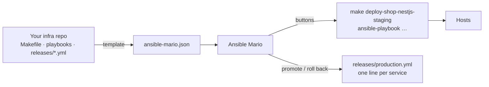

# Ansible Mario

**v2.0.0**: your Ansible project as a desktop app. Deploy, promote, back up and manage machines with buttons, built on the CLI you already use.

[](https://github.com/mariocosttaa/ansible-mario/releases) [](https://docs.ansible.com) [](https://tauri.app) [](https://www.rust-lang.org) [](https://react.dev) [](https://tailwindcss.com) [](LICENSE)

Ansible Mario turns an Ansible repository into an operations app:
- **Servers and products:** pick a server at the top (Staging, Production); see the products that live on it and every service's version.
- **Actions:** buttons to deploy, migrate, seed, close a service for maintenance and reopen it.
- **Builds:** the latest images in your registry (or commits of your app repo), with dates, and where each one is installed. Deploy any of them.
- **Promotion:** move the image staging tested to production, one service at a time.
- **Backups and machines:** restore, provision and verify.
- **Live runs:** every run shows its progress and full log.

Nothing is reimplemented. Every button runs your own Makefile target or playbook through the real `make` / `ansible-playbook`, with your `ansible.cfg`, vault and callbacks.

> The interface is in English by default, with European Portuguese available. It follows the system theme, or stays light or dark.

## Preview


*Services: environment summary, each service's version path (staging → production), and an inspector with the actions.*

| A run in progress | The full log |
| --- | --- |
|  |  |
| *A floating card shows the current step, taken from the `TASK [...]` lines.* | *The steps with timings, plus the colour log. You can cancel from here.* |

| Deploy: choose the mode, then the version | Builds |
| --- | --- |
|  |  |
| *Deploy, deploy + migrations or seed, then any build from the registry. The release line is written first and put back if the deploy fails.* | *Recent builds with date, commit and size, and which server runs each one.* |

| Promote staging → production | Production |
| --- | --- |
|  |  |
| *The same image, one service at a time. Per-environment tags come from the registry, or you type them in.* | *Protected: every action asks you to type `production`.* |


*Light mode. Auto follows the system.*


*First open: the app reads the project, says how compatible it is, and proposes an `ansible-mario.json`.*

## How it works



### Customised by compatibility

The app is driven by an **`ansible-mario.json`** at the root of your infra repo. It is versioned with the project, so the whole team sees the same thing. You don't write it by hand: on first open the app offers a **template** and shows how much of your project it understands:

- **Makefile convention.** Targets named `verb-product-technology-environment` (for example `deploy-shop-nestjs-staging` or `run-migrations-shop-nestjs-production`) become products, services and actions:
  - The environment is the last segment, matched against `inventories/<env>.ini`.
  - Targets without a product (`deploy-backup-*`, `provision-system-*`, `ping-*`) become operations: Backups, Machine, Observability and Verify.
  - Version keys are found in `releases/<env>.yml` (`api_tag`, `shop_app_tag`, `api_commit`…).
- **Playbooks only.** One button per playbook, run with the environment's inventory and release.
- **Blank.** Configure it in **Settings**, where a form and the JSON stay in sync.

The schema is in [`schema/v2.json`](schema/v2.json), so editors autocomplete and validate the file.

What the file describes, and what you can change in **Settings** (or the JSON tab):

| Part | What it is |
| --- | --- |
| `environments` | The **servers**: inventory, release file, colour, and whether actions there ask you to type the name. |
| `products` | Your applications. `environments` lists the servers each one exists on; `placements` puts a product on another product's server with its own `{env}` token, inventory and release (a test stack on the production machine). |
| `services` | The parts of a product. Each has its buttons (`deploy`, `migrate`, `seed`, `maintenanceOn`, `maintenanceOff`), each a Makefile target or a playbook, and its version key. `includesDeploy` marks a migrate or seed that already redeploys. |
| `versions` | Where the deploy picker gets versions from: `registry` tags (read with a `tagFormat` such as `{version}-{env}-{commit}-{build}`), `git` commits of your app repo, or `none`. |
| `operations` | Backups, provisioning, observability and checks, grouped. `destructive` asks for the typed word everywhere. |
| `variables` | Settings the app edits in your YAML: on/off flags, texts, and secrets (Discord webhooks, tokens) written through the vault and never shown. |

### Let an agent write it

[`skills/ansible-mario-json`](skills/ansible-mario-json/SKILL.md) is a skill for coding agents (Claude Code and others). It reads your Makefile, inventories and releases and writes or fixes `ansible-mario.json` without inventing targets or files. Copy it to `.claude/skills/` in your infra repo, or to `~/.claude/skills/`, and ask: *"create the ansible-mario.json for this project"*.

## Features

- **Servers at the top, products in the sidebar:** each server shows only the products that exist on it.
- **Services:** one row per app service, with its tech icon and the version on the chosen server, and a status: *Ready to promote*, *Behind*, *Ahead*, *Stable*, *Closed*, *Failed* or *Running*. Postgres, Redis and nginx sit in a compact infra strip.
- **Inspector:**
  - the version on this server, and a line about the other one;
  - a big **Deploy** action, plus **Migrate**, **Seed**, **Close to the public** and **Reopen**;
  - **Previous version**, which picks an older value from the release file's git history and redeploys it;
  - recent activity.
- **Deploy with a version:** choose *Deploy*, *Deploy + migrations* or *Deploy + migrations + seed* (or *Deploy, then migrate* when your migrate target doesn't redeploy), then the version: any recent build, a commit, or a tag you type. The app writes that service's release line, runs the steps in order, and puts the line back if the deploy fails. It can commit the release file afterwards.
- **Builds:** the most recent images of each service, newest first, with date, size and commit from the image's OCI labels (or from the tag format), and badges for the servers running each one. Results are cached per tag; the registry is only asked when you open the page or press Refresh.
- **Promote:**
  - Compares the release files and copies the tag staging tested, one service at a time: it writes that service's line, deploys, and on failure puts the line back and stops. Your release file never claims a version that isn't running.
  - Apps whose tag carries the environment (`-staging-`) are looked up in the registry, using your `docker login` credentials (config.json or Keychain). If the registry can't answer, you type the tag in.
- **Backups:** install, rehearse a restore on staging, restore production, with scope (`all`, `db`, `storage`) when the Makefile supports it.
- **Machine:**
  - provisioning in order, including a "new machine" sequence that stops at the first failure;
  - open or close apps to users, using the state in your inventory;
  - observability, and read-only checks.
- **Runs:** history with filters, the full log of every run, *copy command* and *run again*.
- **Refresh:** a button in the toolbar, plus automatic refreshes when the app opens, when the window gets focus, and every 3 minutes (configurable, or off). It re-reads releases, run history and the inventory. It never connects to the servers.
- **Settings for everything:** servers, products, buttons, operations, version sources and variables, with searchable selects and live checks against the Makefile. Notification switches and webhooks (for example `deploy_notify_enabled` and a Discord URL in the vault) are edited in place.
- **Preferences:** language (English or Português), theme (Auto, Light, Dark), refresh interval.
- **⌘K:** run any action or jump anywhere.
- **Files (advanced):** the v1 editor is still here, with YAML validation, `ansible-lint`, the vault edited in memory and free-form runs.

## Guard rails

- **Protected environments** (production) ask you to **type the environment name** for every action.
- **Destructive operations** (restore, reset) ask for the typed word in every environment.
- **One run per environment at a time.** The machine never gets two deploys at once.
- **Interactive Makefile locks keep working.** If your Makefile asks with `read` and honours `CONFIRM=yes`, the app asks the question itself, then passes `CONFIRM=yes`.
- **Missing targets are disabled.** A button whose target isn't in the Makefile is greyed out, and Settings lists what drifted.
- **Nothing is invented on screen.** Versions come from the release files, "last deploy" from the app's own history, maintenance state from the inventory, and notifications from your `callbacks_enabled`.
- **Quitting during a run asks first.**

## Quick start

### Install

1. Download `Ansible-Mario-2.0.0-macos-arm64.dmg` (or the `.zip`) from the [latest release](https://github.com/mariocosttaa/ansible-mario/releases/latest), and drag **Ansible Mario.app** to `/Applications`.
2. The app is not signed with an Apple Developer ID yet, so allow it once:

   ```bash
   xattr -dr com.apple.quarantine "/Applications/Ansible Mario.app"
   ```

**Requirements:** a Mac with Apple Silicon, Ansible (`ansible-core`) and `make`. `ansible-lint` and `docker login` are optional. The app reads your login shell's `PATH`, so tools in `~/.local/bin` or `/opt/homebrew/bin` are found even when it's opened from Finder.

### Try the demo

[`examples/demo-infra`](examples/demo-infra) follows the convention and already has its `ansible-mario.json`. Its "machines" are **this computer over a local connection**, so you can really deploy, promote, migrate and restore without touching any server:

```bash
git clone https://github.com/mariocosttaa/ansible-mario.git
open -a "Ansible Mario" --args "$PWD/ansible-mario/examples/demo-infra"
```

### Open your own project

```bash
ln -s "$PWD/ansible-mario/bin/ansible-mario" /usr/local/bin/ansible-mario
cd ~/infra/my-project && ansible-mario
```

## Build from source

```bash
npm install
npm run tauri dev                              # development
npm run tauri build -- --bundles app,dmg       # src-tauri/target/release/bundle/
```

You need Node 20 or newer, Rust (stable) and the Xcode Command Line Tools.

### Tests

```bash
cd src-tauri && cargo test --lib
```

What the tests cover:
- the template parser;
- release rewrites that keep comments;
- registry tag matching and tag-format parsing;
- a real vault round trip;
- real `ansible-playbook` runs on localhost, including streaming and cancelling.

To check the template against your own repositories, read-only:

```bash
ANSIBLE_MARIO_FIXTURES=~/infra/a:~/infra/b cargo test --lib -- --nocapture template::
```

## Project structure

| Path | What is in it |
| --- | --- |
| `src-tauri/src/manifest.rs` | The `ansible-mario.json` model, and validation against the Makefile. |
| `src-tauri/src/template.rs` | The Makefile-convention and playbooks templates, and the compatibility report. |
| `src-tauri/src/releases.rs` | Reads and rewrites `releases/*.yml` line by line, keeping comments. |
| `src-tauri/src/registry.rs` | Registry tags and build details (date, size, OCI labels) with `docker login` credentials; tag-format parsing. |
| `src-tauri/src/ops.rs` | Maintenance flags from the inventory, and release history and commits from git. |
| `src-tauri/src/runner.rs` | Runs in a process group: streaming, cancelling, history, one run per environment. |
| `src/v2/` | The app: shell, pages (Services, Builds, Promote, Backups, Machine, Runs, Settings), the deploy dialog, ⌘K, the run views, and the English/Portuguese strings. |
| `src/legacy/` | The v1 editor, now *Files (advanced)*. |
| `schema/v2.json` | JSON schema for `ansible-mario.json`. |
| `skills/ansible-mario-json` | A skill that helps coding agents write `ansible-mario.json` for a project. |
| `examples/demo-infra` | A demo project that runs on localhost. |

## Limitations

- Apple Silicon only, and unsigned. Linux and an Intel build are planned.
- There's no snapshot list unless your Makefile has a target that prints one. Restores use `latest` or the name you type.
- Container status (running or unhealthy) comes from your `status-*` target when you run it. It is not live.

## License

[MIT](LICENSE) © Mário Costa
