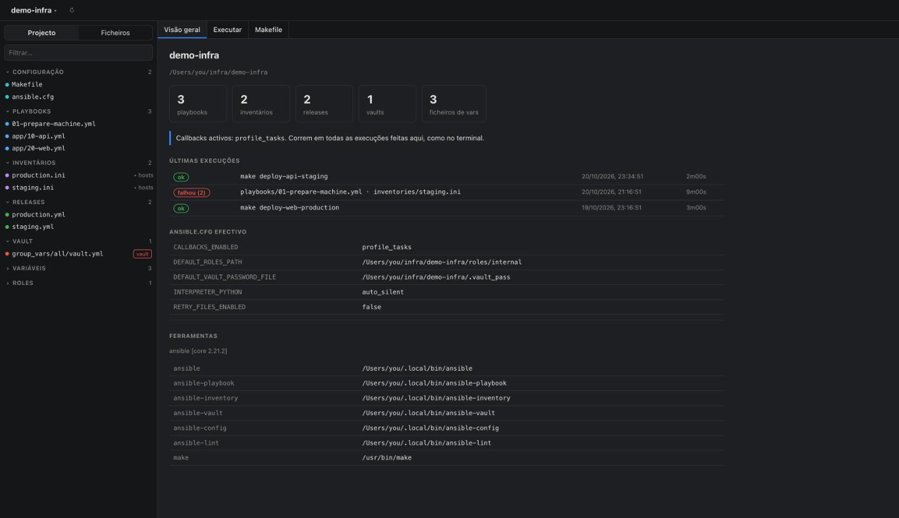
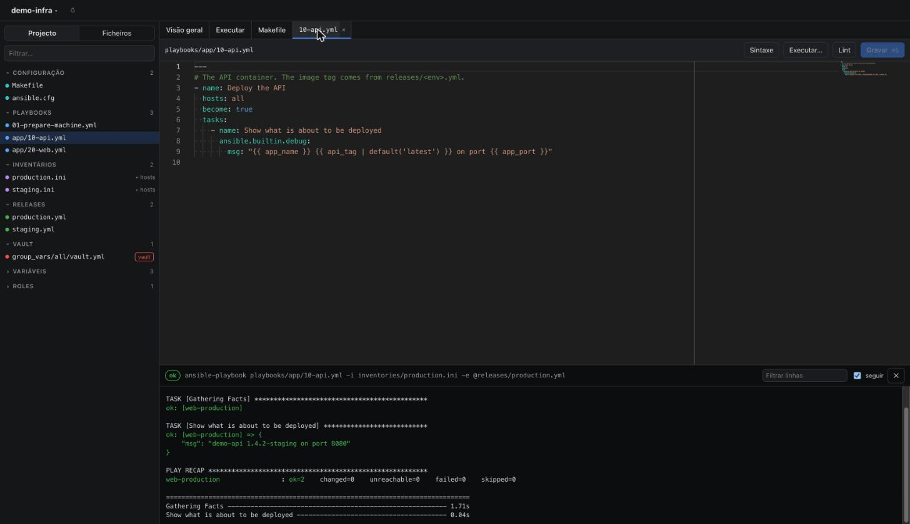
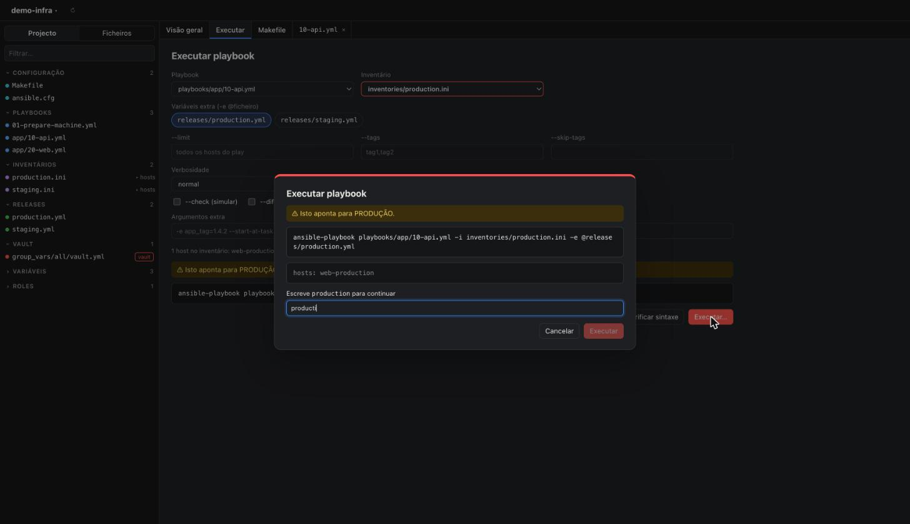
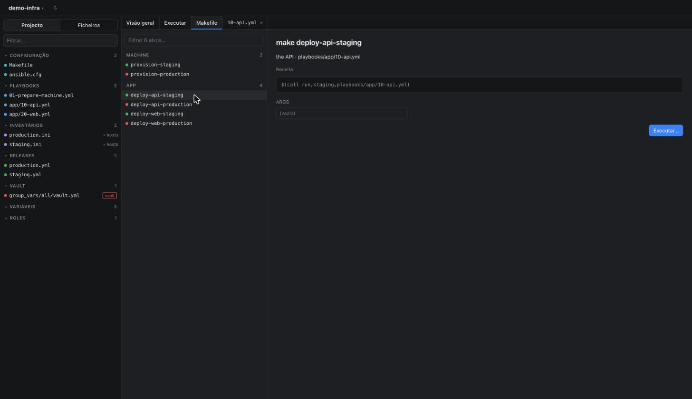
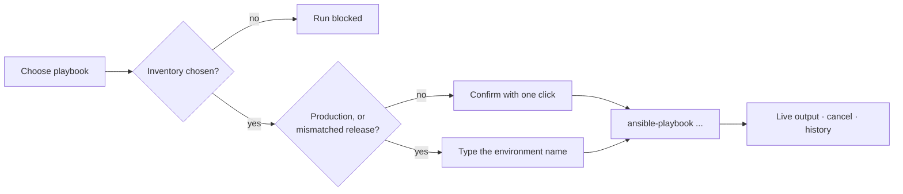
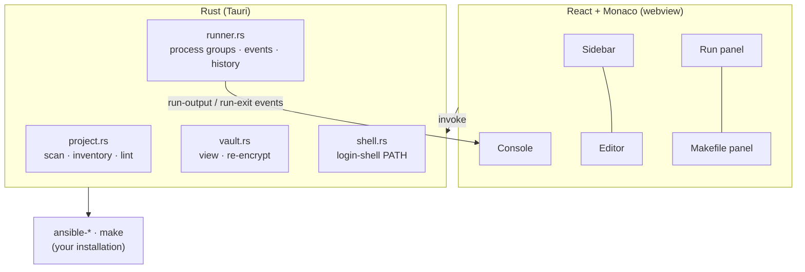

<h1>
  <picture>
    <source media="(prefers-color-scheme: dark)" srcset="https://raw.githubusercontent.com/mariocosttaa/tillerdeck/main/docs/brand/marca-horizontal-branco.svg">
    
  </picture>
</h1>

*Tillerdeck 1.0.1 is Ansible Mario 1.0 with its new name. For the operations app, see [v2](https://github.com/mariocosttaa/tillerdeck/releases).*

**v1.0.1**: a native macOS app to browse, edit and run your Ansible projects, built on the CLI you already use.

[](https://github.com/mariocosttaa/tillerdeck/releases) [](https://docs.ansible.com) [](https://tauri.app) [](https://www.rust-lang.org) [](https://react.dev) [](https://www.typescriptlang.org) [](https://microsoft.github.io/monaco-editor/) [](LICENSE)

Tillerdeck opens any Ansible project (the folder with your `ansible.cfg`) and gives you one window for the whole loop. You can see what is in the project and edit the YAML without losing a comment. Vaults decrypt in memory only. Playbooks and Makefile targets run with live output. It has guard rails that make deploying to the wrong environment hard.

It does not replace Ansible. Every action calls the real CLI on your machine (`ansible-playbook`, `ansible-inventory`, `ansible-vault`, `ansible-config`, `ansible-lint`, `make`), with your `ansible.cfg`, plugins and callbacks. A run from the app does exactly what the same command does in your terminal.

> The interface is in European Portuguese for now. English is planned for v2.

## Preview



*Overview: project stats, recent runs, the effective `ansible.cfg` and the tools found on your PATH.*

| Editor and live run | Production guard |
| --- | --- |
|  |  |
| *Monaco with YAML validation, plus the run console with ANSI colours.* | *Production runs need you to type the environment name.* |



*Makefile targets (`target: ## description`, `##@ Section`) become actions. You see the recipe before anything runs.*

## Features

- **Project view:** finds the `ansible.cfg` and classifies playbooks, inventories, releases (`releases/*.yml`), `group_vars`/`host_vars`, vaults and roles.
- **Inventories:** groups and hosts come from `ansible-inventory --list`. Host variables, which can include decrypted vault values, stay in the backend and never reach the UI.
- **Editor:** Monaco with live YAML validation, `ansible-lint` markers and `--syntax-check`. Files are saved as text, so comments always survive. Invalid YAML needs an explicit "save anyway".
- **Vault:** `$ANSIBLE_VAULT` files open decrypted in memory and are re-encrypted on save through stdin. Plaintext never touches the disk, not even as a temp file. The password comes from your project's `vault_password_file`.
- **Run playbooks:** pick the playbook, inventory, `-e @release`, `--limit`, `--tags`, `--check`, `--diff`, `-v` and extra args. Output streams live with colours. Cancel sends SIGINT, then SIGTERM, then SIGKILL to the whole process group. Every run goes into the history with its full log.
- **Makefile actions:** targets are listed by section, with their recipe shown before running.
- **CLI launcher:** `tillerdeck .` opens the current folder in the app.

## Guard rails



- **There is never a default inventory.** You always choose the environment yourself.
- **Production needs a typed confirmation.** When the inventory, a release file, `--limit`, a host, a group or a make target looks like production, you type the environment name to continue.
- **Mismatched environments are flagged.** `inventories/production.ini` together with `releases/staging.yml` shows a warning and asks for the same typed confirmation.
- **Destructive make targets ask too.** Targets that wipe, reset or restore data need the typed word even outside production.
- **Interactive Makefile locks keep working.** Some Makefiles ask with `read` and honour `CONFIRM=yes`. Without a terminal that `read` would just fail, so the app asks for the word itself and then passes `CONFIRM=yes`.
- **Quitting mid-run asks first.** Closing the window or pressing ⌘Q during a run, or with unsaved files, shows a dialog. Quitting would stop Ansible in the middle of a task.
- **The app only touches the open project.** Reading, writing and running are limited to that folder.

## Quick start

### Install the app

1. Download `Tillerdeck-1.0.1-macos-arm64.dmg` (or the `.zip`) from the [latest release](https://github.com/mariocosttaa/tillerdeck/releases/latest).
2. Open it and drag **Tillerdeck.app** to `/Applications`.
3. The app is not signed with an Apple Developer ID yet, so macOS blocks it the first time. Allow it once:

   ```bash
   xattr -dr com.apple.quarantine "/Applications/Tillerdeck.app"
   ```

   Or right-click the app, choose **Open**, then confirm.

**Requirements:**
- A Mac with Apple Silicon.
- Ansible installed (`pipx install ansible-core`, `brew install ansible` or `pip install --user ansible`).
- Optionally `ansible-lint`.

A macOS app opened from Finder does not inherit your terminal's `PATH`. Tillerdeck reads the `PATH` from your login shell (`$SHELL -ilc`), so tools in `~/.local/bin` or `/opt/homebrew/bin` are found. The Overview tab shows where each tool was found.

### Open a project from the terminal

```bash
git clone https://github.com/mariocosttaa/tillerdeck.git
ln -s "$PWD/tillerdeck/bin/tillerdeck" /usr/local/bin/tillerdeck

cd ~/infra/my-project
tillerdeck            # or: tillerdeck <folder>
```

### Try it with the demo project

[`examples/demo-infra`](examples/demo-infra) is a small project with two environments, release files, a vault (password `demo`) and a Makefile:

```bash
tillerdeck examples/demo-infra
```

Its hosts are placeholder addresses (`192.0.2.x`), so real runs fail to connect. Syntax checks, lint, the inventory view and the vault editor all work offline.

## Build from source

```bash
npm install
npm run tauri dev                        # development, with hot reload
npm run tauri build -- --bundles app     # src-tauri/target/release/bundle/macos/Tillerdeck.app
```

You need Node 20 or newer, Rust (stable) and the Xcode Command Line Tools.

### Tests

```bash
cd src-tauri
cargo test --lib
```

The tests run real Ansible: playbooks against `localhost` over a local connection, a vault round trip, lint parsing, and tool discovery. No remote machine is touched. To check your own projects read-only (scan, inventory, syntax check, decrypting the vault in memory):

```bash
TILLERDECK_FIXTURES=~/infra/a:~/infra/b cargo test --lib -- --nocapture
```

## How it works



## Project structure

| Path | What is in it |
| --- | --- |
| `src-tauri/src/shell.rs` | Reads the login-shell `PATH` and starts external commands. |
| `src-tauri/src/project.rs` | Scans the project and classifies files; handles the Makefile, `ansible-config`, `ansible-inventory`, lint and syntax check. |
| `src-tauri/src/vault.rs` | Views and saves vaults without plaintext on disk. |
| `src-tauri/src/runner.rs` | Runs commands in their own process group, emits output events, cancels and keeps the history. |
| `src-tauri/src/lib.rs` | The Tauri commands and the quit guard. |
| `src/` | The React UI: `App.tsx`, `api.ts`, `monaco.ts` and the `components/` folder. |
| `bin/tillerdeck` | The CLI launcher. |
| `examples/demo-infra` | A demo Ansible project. |

The history and run logs live in `~/Library/Application Support/pt.solo.tillerdeck/`.

## Limitations

- Apple Silicon only, and the app is unsigned. An Intel build, signing and notarisation are planned.
- The interface is in Portuguese only.
- Files can't be created, renamed or deleted from the app yet.

## License

[MIT](LICENSE) © Mário Costa
